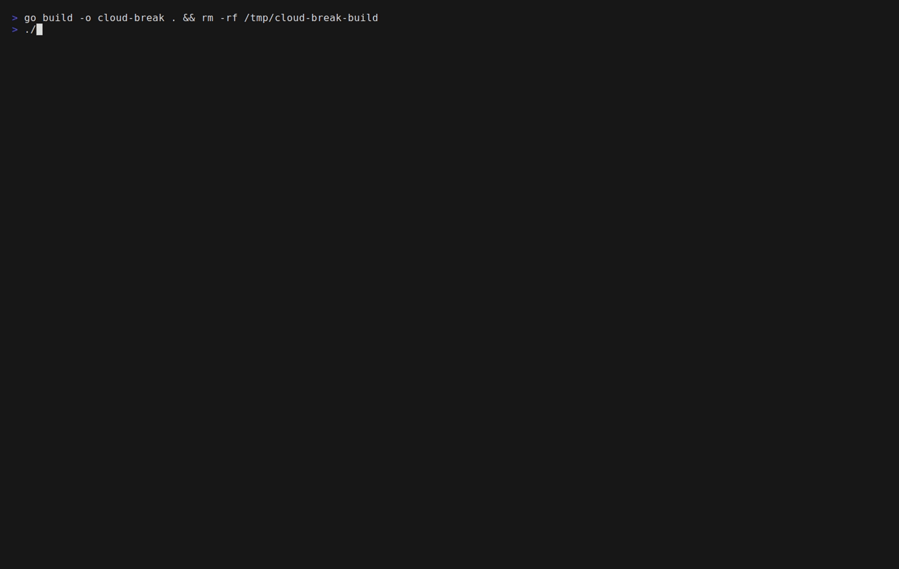
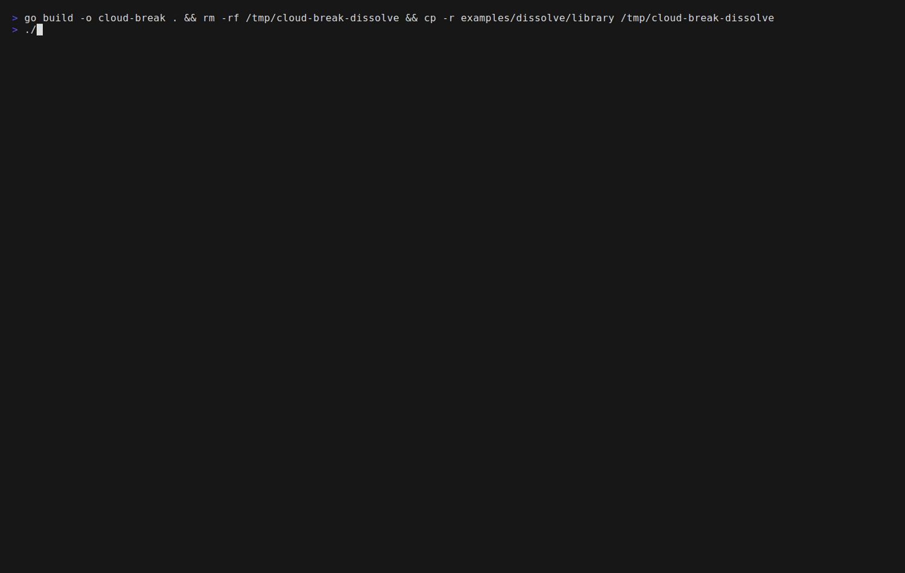

# cloud-break

cloud-break is a tui program designed to help create and resolve [Evaportating Clouds](https://en.wikipedia.org/wiki/Evaporating_cloud).

It has two front ends onto one library: the interface, and a command line that
reads and writes the same JSON documents.

## What is an "Evaporating Cloud"?

In short, it is a thinking tool designed for resolving conflicts between two conflicting ideas. Typically these conflicts are the result of one or more assumptions. 

The "cloud" is a specific diagram for labeling and seeing the conflicting statements.

"Evaporating" the cloud is the process of finding assumptions made in one or more of the statements being made by providing cause and evidence for a claim.
If a claim cannot be supported by a cause and evidence (or a chain of such) then it is fudementally an assumption rather than fact. Once assumptions are
clear the conflict is often easily resolved by constructing a win-win solution to replace that assumed claim.

## Reading Evaporating Cloud

```
                    ╭─ A · Objective ─────╮
                    │ ship on time        │
                    ╰──────────┬──────────╯
                               │
             ┌─────────────────┴─────────────────┐
             │                                   │
╭─ B · Need (Us) ─────╮             ╭─ C · Need (Them) ───╮
│ no regressions      │             │ promised features   │
╰──────────┬──────────╯             ╰──────────┬──────────╯
╭─ D · Want (Us) ─────╮             ╭─ D' · Want (Them) ──╮
│ freeze the scope    │◄─────×─────►│ add every feature   │
╰─────────────────────╯             ╰─────────────────────╯

assumptions  A-B 0 · A-C 0 · B-D 2 · C-D' 0 · D-D' 1
```

Read down: in order to achieve A you must satisfy B and C; in order to satisfy
B you must do D, and in order to satisfy C you must do D'. The `×` is the
conflict. The ledger under the figure counts the assumptions on each arrow,
coloured by the weakest verdict among them.

## See it

Building a cloud from an empty library:



Challenging the assumptions of a complete cloud until one breaks:



Both recordings are generated from the tapes in [`examples/`](examples), which
also documents how to re-record them.

[`examples/library/`](examples/library) holds ten more clouds to browse, each in a
different state: five everyday conflicts, and five classic hard problems —
consistency against availability, cache invalidation, retries without
duplicates, schema changes without downtime, and rewriting against refactoring.
`cloud-break --demo` opens them in a throwaway library.

## Installation

```sh
go install github.com/madxmike/cloud-break@latest
```

Prebuilt binaries for Linux, macOS and Windows (amd64 and arm64) are on the
[releases page](https://github.com/madxmike/cloud-break/releases). Building from
source is just:

```sh
go build -o cloud-break .
```

## Running it

```sh
cloud-break              # opens the library
cloud-break --demo       # a temporary library holding the example clouds
cloud-break -dir ./clouds
cloud-break -version
```

Clouds live in one JSON file each, under the first of:

1. `-dir` on the command line
2. `$CLOUD_BREAK_HOME`
3. `$XDG_DATA_HOME/cloud-break`
4. `~/.local/share/cloud-break`

## Usage

A command works on the library described above instead of opening it. The five
statements are written first, then the assumptions on the arrows, then a verdict,
an injection and a verification:

```sh
id=$(cloud-break new --title "Release scope" --parties "Eng,Sales")
cloud-break set "$id" A "ship on time"
cloud-break set "$id" B "no regressions"
cloud-break set "$id" C "promised features"
cloud-break set "$id" D "freeze the scope"
cloud-break set "$id" D2 "add every feature"

weak=$(cloud-break assume add "$id" B-D "scope cannot change without regressions")
cloud-break assume verdict "$id" "$weak" invalid --evidence "we hotfixed twice"
cloud-break inject add "$id" --breaks "$weak" "cut scope to a fixed date"

cloud-break check "$id"
cloud-break verify "$id"
cloud-break show "$id"
```

A command writes its data to standard output and its diagnostics to standard
error, and reports the outcome in its exit status: `0` the command ran, `1` it
failed or a check found an error, `2` the command line cannot be used, `130` it
was interrupted. A command that writes prints the id it acted on, and a cloud,
an assumption or an injection may be named by any unambiguous prefix of its id.
`--json` prints the same data as JSON, with every field always present.

Set `CLOUD_BREAK_HOME` to choose the library; `--dir` overrides it. `--demo`
works on a throwaway copy of the example clouds and takes no `--dir`.

For the five statements, the arrows and the words the commands accept see
`cloud-break --help clouds`. For the output shapes and the sequence above see
`cloud-break --help agent`. For the whole manual see `cloud-break --man`.

[`examples/library/`](examples/library) holds clouds in every state, and
`cloud-break --demo list` reads them without copying anything.

## Processing a cloud

The **process** pane tracks the five stages and derives each one from the
cloud's own contents:

1. **State the conflict** — all five statements are filled in.
2. **Surface the assumptions** — every arrow has at least one "because".
3. **Find the weak link** — an assumption has been judged invalid.
4. **Inject a breakthrough** — an injection breaks that assumption.
5. **Verify** — you confirm the injection dissolves the conflict.

A cloud's status follows the same evidence: `draft` until the statements are
complete, `open` while nothing has fallen, `dissolving` once an assumption is
invalid, and `dissolved` only after an injection breaks it *and* you verify it.
Nothing is ever marked dissolved on your behalf.

## Keys

| Where | Keys |
|:--|:--|
| Library | `↑/k` `↓/j` move · `enter` open · `n` new · `d` delete · `q` quit |
| Statements | `↑/k` `↓/j` move · `enter` edit · `t` title · `s` name the sides |
| Cloud figure | `2` — the diagram has its own pane on narrow terminals |
| Assumptions | `↑/k` `↓/j` move · `a` add · `enter` edit · `v` verdict · `e` evidence · `i` instead · `r` why it works · `x` delete |
| Process | `V` verify — works from any pane |
| Anywhere | `1`–`4` jump to pane · `←`/`→` `tab` `shift+tab` cycle · `?` help · `esc/q` back · `^C` quit |

`instead` is the injection: the change that makes the claim irrelevant. It is
typed in its slot, like the claim itself.

Verdicts cycle through unassessed, holds, questionable and invalid. The verdict
is a judgement about the *assumption*, not about the person who holds it: mark
one invalid when you can show it does not hold, then say what breaks it.

## License

MIT. See [LICENSE](LICENSE).
